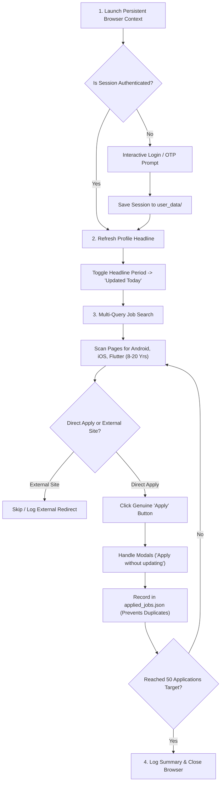

# 🚀 Naukri Profile Freshener & Job Automator

[](https://www.python.org/)
[](https://playwright.dev/)
[](https://www.microsoft.com/)
[](https://www.apple.com/macos/)
[](https://www.linux.org/)
[](https://opensource.org/licenses/MIT)

An intelligent, full-lifecycle automation suite designed to keep your Naukri profile ranking at the top of recruiter search results and automatically submit direct applications for senior mobile engineering roles (Android, iOS, Flutter, Cross-Platform).

---

## 📌 Executive Summary

In the competitive Indian tech hiring market, securing recruiter interviews on Naukri hinges on two factors:
1. **Recruiter Search Ranking**: Naukri heavily indexes candidates with an **"Updated Today / Active Today"** status. Profiles untouched for more than a few days drop off the first few search pages.
2. **Speed & Volume**: Top senior openings receive hundreds of applicants within 24–48 hours. Applying consistently without manual fatigue is critical.

This tool runs daily to refresh your profile timestamp (increasing recruiter profile views by **3–5x**), scans multi-page job listings across major tech hubs, and automatically submits up to **50 direct applications** daily while filtering out bookmarks, third-party redirects, and duplicate postings.

---

## 💡 The 3 Core Problems It Solves

| Challenge | Why It Happens | How This Suite Solves It |
| :--- | :--- | :--- |
| **Recruiter Visibility Drop** | Naukri’s algorithm favors candidates active today. Inactive profiles sink to lower pages. | Automatically toggles a trailing period on your resume headline daily, updating your profile timestamp to **"Updated Today"** without altering your real content. |
| **Application Burnout** | Manually searching and applying to 50+ roles takes 1–2 hours of repetitive clicking daily. | Automates multi-page scanning, keyword filtering, and form submission in just a few minutes. |
| **Scraper Pitfalls (Save vs. Apply)** | Naukri places the **"Save" (Bookmark)** button beside the **"Apply"** button in the same container. Naive scrapers often click "Save" instead. | Employs strict DOM text matching to guarantee genuine application submissions, while filtering out third-party ATS redirects (Workday, Taleo, etc.). |

---

## 🏗️ Architecture & Workflow



---

## ⚙️ How It Works (Step-by-Step)

### 1. Persistent Session & Anti-Bot Protection
- Uses Playwright Chromium with a persistent user directory (`user_data/`).
- You log in with your credentials and OTP once; all session cookies and tokens are preserved across runs.
- Configured with desktop user-agent headers and non-headless browser flags to bypass Cloudflare/PerimeterX bot detection.

### 2. The Headline Freshener ("Recruiter Algorithm Booster")
- Navigates to `https://www.naukri.com/mnjuser/profile`.
- Locates the Resume Headline section and edits it by toggling a trailing period (`.` $\leftrightarrow$ empty).
- Clicking Save signals Naukri’s indexing engine that your profile was actively modified today, placing you in the highest-priority search bracket for recruiters.

### 3. Flexible Multi-Role Job Discovery
- Reads customizable filters from `config.json`:
  - **Keywords**: `Android`, `iOS`, `Flutter`, `Mobile Developer`, `Mobile Lead`, `Mobile Architect`, `React Native Mobile`.
  - **Experience**: Flexible `8` to `20` years window.
  - **Locations**: Bengaluru, Hyderabad, Pune, and Remote.
- Traverses multi-page search results (`Page 1`, `Page 2`, `Page 3`...) using gradual scrolling to trigger React client-side hydration and lazy-loaded job cards.

### 4. Smart Application Engine
- Evaluates each job:
  - **Duplicate Check**: Verifies the job URL against `applied_jobs.json`.
  - **Strict Button Detection**: Distinguishes genuine platform apply buttons from bookmark buttons and third-party company site redirects.
  - **Modal Handling**: Automatically navigates through confirmation modals such as *"Apply without updating resume"*.
  - **State Persistence**: Records applied jobs to prevent redundant applications in future runs.

---

## 📂 Project Structure

```text
naukri-job-automation/
├── naukri_automator.py      # Core automation logic (Playwright engine)
├── run_daily.ps1            # Daily runner script (PowerShell)
├── login.ps1                # One-time login launcher (PowerShell)
├── config.json              # Active user configuration
├── config.example.json      # Template configuration file
├── requirements.txt         # Python dependencies
├── .gitignore               # Excludes sensitive sessions and logs
└── README.md                # Comprehensive documentation
```

---

## 🛠️ Prerequisites & Installation

### Step 1: Install Python 3.10+

<details>
<summary><b>🪟 Windows</b></summary>

**Option A — Microsoft Store (Easiest):**
1. Open **Microsoft Store**, search for **Python 3.12**, click **Install**.

**Option B — Official Installer:**
1. Go to [python.org/downloads](https://www.python.org/downloads/windows/)
2. Download the latest **Python 3.12.x Windows installer (64-bit)**.
3. Run the installer — **tick "Add Python to PATH"** before clicking Install.
4. Verify:
   ```powershell
   python --version
   pip --version
   ```

**Option C — winget (PowerShell):**
```powershell
winget install --id Python.Python.3.12 -e --source winget
```

</details>

<details>
<summary><b>🍎 macOS</b></summary>

**Option A — Homebrew (Recommended):**
1. Install Homebrew (if not already installed):
   ```bash
   /bin/bash -c "$(curl -fsSL https://raw.githubusercontent.com/Homebrew/install/HEAD/install.sh)"
   ```
2. Install Python:
   ```bash
   brew install python@3.12
   ```
3. Verify:
   ```bash
   python3 --version
   pip3 --version
   ```

**Option B — Official Installer:**
1. Go to [python.org/downloads](https://www.python.org/downloads/macos/)
2. Download the latest **macOS installer (.pkg)**.
3. Run the `.pkg` file and follow the setup wizard.
4. Verify in Terminal:
   ```bash
   python3 --version
   ```

</details>

---

### Step 2: Clone the Repository

```bash
git clone https://github.com/ashokkateshiya/naukri-job-automation.git
cd naukri-job-automation
```

> **Don't have Git?**
> - **Windows**: `winget install --id Git.Git -e --source winget` then restart terminal.
> - **macOS**: Run `git` in Terminal — macOS will prompt you to install Xcode Command Line Tools automatically.

---

### Step 3: Install Python Dependencies

<details>
<summary><b>🪟 Windows (PowerShell)</b></summary>

```powershell
pip install -r requirements.txt
```

</details>

<details>
<summary><b>🍎 macOS / Linux (Terminal)</b></summary>

```bash
pip3 install -r requirements.txt
```

> **Tip**: If you get a permissions error, use a virtual environment:
> ```bash
> python3 -m venv venv
> source venv/bin/activate
> pip install -r requirements.txt
> ```

</details>

---

### Step 4: Install Playwright & Chromium Browser

Playwright manages its own browser binaries — no manual Chrome download needed.

<details>
<summary><b>🪟 Windows (PowerShell)</b></summary>

```powershell
playwright install chromium
```

</details>

<details>
<summary><b>🍎 macOS / Linux (Terminal)</b></summary>

```bash
playwright install chromium
```

> **macOS only**: If you see a security warning when Playwright tries to open Chromium, go to  
> **System Settings → Privacy & Security → Allow Anyway**.

</details>

---

### Step 5: Copy & Customize Configuration

```bash
cp config.example.json config.json
```

Then edit `config.json` to adjust your keywords, locations, experience range, and daily application target. See the [Configuration](#️-configuration-configjson) section below.

---

### ✅ Verify Everything Is Ready

Run this to confirm all tools are installed and working:

<details>
<summary><b>🪟 Windows</b></summary>

```powershell
python --version
pip show playwright
playwright --version
```

</details>

<details>
<summary><b>🍎 macOS / Linux</b></summary>

```bash
python3 --version
pip3 show playwright
playwright --version
```

</details>

All three commands should return version numbers without errors. You are ready to run the automation!

---

## ⚙️ Configuration (`config.json`)

Customize your search filters and application limits:

```json
{
  "keywords": [
    "Android",
    "iOS",
    "Flutter",
    "Mobile Developer",
    "Mobile Engineer",
    "Android Developer",
    "iOS Developer",
    "Flutter Developer",
    "Mobile Lead",
    "Mobile Architect",
    "React Native Mobile"
  ],
  "locations": [
    "Bengaluru",
    "Hyderabad",
    "Pune",
    "Remote"
  ],
  "experience_min_years": 8,
  "experience_max_years": 20,
  "refresh_profile_daily": true,
  "auto_apply_easy_apply": true,
  "max_applications_per_run": 50,
  "max_pages_per_keyword": 5,
  "browser_user_data_dir": "user_data",
  "headless": false
}
```

---

## 🚀 Usage

### Daily Routine (Profile Refresh + Auto-Apply)

**Windows (PowerShell):**
```powershell
powershell -ExecutionPolicy Bypass -File ./run_daily.ps1
```

**macOS / Linux (Terminal):**
```bash
python3 naukri_automator.py --login
chmod +x run_daily.sh
./run_daily.sh
```

**Or directly with Python (any platform):**
```bash
python naukri_automator.py --daily
```

- **First Run**: If unauthenticated, a Chrome window will open. Enter your credentials and OTP once.
- **Subsequent Runs**: Automatically executes fully unattended, updating your profile timestamp and applying for jobs up to your daily target.

### Profile Refresh Only

To refresh your profile without applying for jobs:
```bash
python naukri_automator.py --refresh
```

---

## 🔒 Security & Privacy

- **Session Isolation**: `.gitignore` strictly excludes `user_data/` and `storage_state.json`. Your credentials, session cookies, and authentication tokens are never pushed to GitHub.
- **Application History**: `last_run.log` and `applied_jobs.json` are excluded to keep your job search history private.

---

## 📜 License

Distributed under the MIT License. See `LICENSE` for more information.
